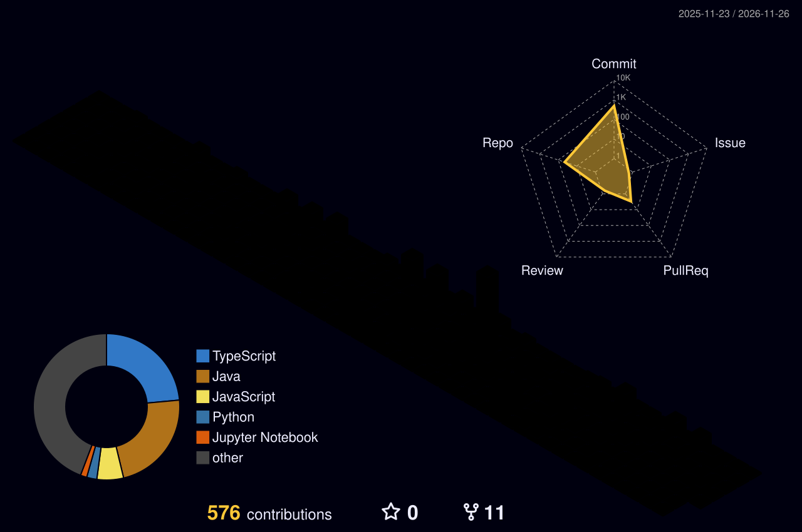

<center>
  
</center>

<table border="0">
  <tr>
    <td width="68%" valign="top">
      <div align="justify">
        <p>
          Hi, I’m <strong>Hari Prasath LV</strong>, an <strong>AI & DS graduate</strong> focused on developing practical software solutions and AI-driven applications. I work across frontend and backend development, using <strong>Java, Python, React, JavaScript, and SQL</strong> to translate requirements into functional, maintainable products.
        </p>
        <p>
          My projects involve <strong>multi-agent systems, retrieval-augmented applications, and intelligent workflows</strong>, with an emphasis on usability, validation, and reliable execution. I aim to contribute by understanding product requirements, delivering well-structured implementations, and continuously improving software through testing, problem-solving, and thoughtful development.
        </p>
      </div>
    </td>
  </tr>
</table>

<br>

<div align="center">
  <b>🌐 Connect With Me</b><br><br>
  <a href="https://www.instagram.com/hariprasath_dlh">
    
  </a>
  &nbsp;
  <a href="https://www.linkedin.com/in/hariprasath-lv/">
    
  </a>
  &nbsp;
  <a href="https://hariprasath-dlh.github.io/hariprasath-portfolio/">
    
  </a>
  &nbsp;
  <a href="mailto:hariprasathdlhdlh@gmail.com">
    
  </a>
</div>

<h2 align="center">🧰 <strong>SKILLS</strong></h2>

<table align="center" border="0">
  <tr>
    <td align="center">
      
    </td>
    <td align="center">
      
    </td>
    <td align="center">
      
    </td>
    <td align="center">
      
    </td>
    <td align="center">
      
    </td>
  </tr>

  <tr>
    <td align="center">
      
    </td>
    <td align="center">
      
    </td>
    <td align="center">
      
    </td>
    <td align="center">
      
    </td>
    <td align="center">
      
    </td>
    <td align="center">
      
    </td>
  </tr>

  <tr>
    <td align="center">
      
    </td>
    <td align="center">
      
    </td>
    <td align="center">
      
    </td>
    <td align="center">
      
    </td>
    <td align="center">
      
    </td>
  </tr>

  <tr>
    <td align="center">
      
    </td>
    <td align="center">
      
    </td>
    <td align="center">
      
    </td>
  </tr>
</table>

<strong>TOP PROJECTS</strong>

<details>
  <summary><strong>🛡️ AgentGuard — Runtime Governance & Security Platform for Autonomous AI Agents</strong></summary>
  <br>
  <strong>Tech Stack:</strong> Python, FastAPI, React, PostgreSQL, Redis, Playwright, Pytest, GitHub Actions.
  <br><br>
  <strong>Problem Addressed:</strong> Autonomous AI agents can execute tool calls without sufficient runtime controls, creating risks involving unauthorized access, resource consumption, high-risk operations, and auditability.
  <br><br>
  <ul>
    <li>Designed a <strong>framework-agnostic governance layer</strong> that intercepts AI agent tool requests before execution and evaluates them against role-based access controls, risk policies, rate limits, and resource budgets.</li>
    <li>Implemented a <strong>deterministic policy evaluation engine</strong> with <code>ALLOW</code>, <code>DENY</code>, and <code>PENDING</code> decisions, incorporating human approval workflows for high-risk operations and SHA-256 hash-chained audit records.</li>
    <li>Developed a <strong>full-stack administration dashboard</strong> using React and FastAPI, backed by PostgreSQL and Redis, to manage agents, permissions, policies, approval requests, and audit records.</li>
    <li>Validated backend, API, database, and SDK workflows using <strong>Pytest</strong> and automated authentication, role-based access, and dashboard scenarios using <strong>Playwright</strong>; integrated <strong>GitHub Actions</strong> for continuous testing and build validation.</li>
  </ul>
</details>

<details>
  <summary><strong>🤖 Intellexa AI — Multi-Agent Research & Intelligence System</strong></summary>
  <br>
  <strong>Tech Stack:</strong> React, Node.js, Express.js, OpenRouter API, Serper.dev.
  <br><br>
  <strong>Problem Addressed:</strong> Conventional AI chatbot systems often produce unstructured responses without systematically assessing source credibility, identifying conflicting information, or presenting research findings in an organized manner.
  <br><br>
  <ul>
    <li>Designed a <strong>multi-agent research architecture</strong> that divides complex user queries into specialized stages, including query understanding, information retrieval, filtering, credibility assessment, contradiction detection, and insight generation.</li>
    <li>Integrated <strong>Serper.dev</strong> for real-time web research and <strong>OpenRouter</strong> for LLM-powered processing, enabling agents to retrieve, evaluate, and synthesize information from multiple sources.</li>
    <li>Developed <strong>REST API services</strong> using Node.js and Express.js to coordinate agent execution, process research requests, and manage communication between the frontend and backend.</li>
    <li>Built an <strong>interactive React dashboard</strong> that presents structured research results, including direct answers, key insights, and critical factors; validated API communication and endpoint behaviour using <strong>Thunder Client</strong>.</li>
  </ul>
</details>

<details>
  <summary><strong>⚙️ RootMind — Autonomous Multi-Agent AIOps & Incident Response Platform</strong></summary>
  <br>
  <strong>Tech Stack:</strong> Python, FastAPI, LangGraph, Scikit-learn, Groq (Llama 3), Qdrant Cloud, React, SQLite, GitHub API, Slack Webhooks.
  <br><br>
  <strong>Problem Addressed:</strong> Traditional incident management requires engineers to manually investigate system telemetry, correlate logs with code changes, identify root causes, and prepare incident documentation, increasing troubleshooting time and operational effort.
  <br><br>
  <ul>
    <li>Developed an <strong>autonomous multi-agent workflow</strong> to analyse infrastructure telemetry, identify abnormal CPU, memory, and latency patterns, and initiate automated incident diagnostics.</li>
    <li>Integrated Scikit-learn's <strong>Isolation Forest</strong> for anomaly detection and <strong>LangGraph</strong> for agent orchestration, combining <strong>Qdrant-powered Retrieval-Augmented Generation (RAG)</strong> with Groq Llama 3 for code-context retrieval and root cause analysis.</li>
    <li>Implemented <strong>GitHub API integration</strong> to retrieve repository and commit information, generate context-aware code patch suggestions for review, and produce structured incident post-mortem reports.</li>
    <li>Developed a <strong>React-based monitoring dashboard</strong> with FastAPI services, SQLite incident persistence, and Slack webhook notifications; covered anomaly detection, root cause analysis, patch generation, and API workflows through backend testing.</li>
  </ul>
</details>

##  GitHub Contributions



---

### ✍️Quote
```
"சிந்தனை கனவாக மாறும்           "Thought becomes a dream
கனவு செயலாக மாறும்                Dreams become action
செயல் வெற்றியாக மாறும்."           Action becomes success."
```
